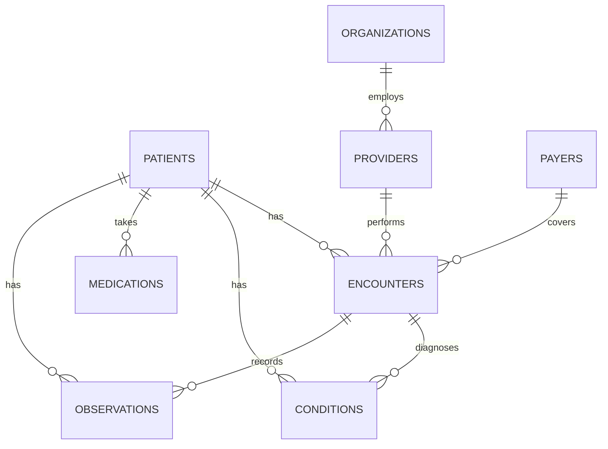

# Healthcare SQL Analytics — Synthea Patient Data

SQL analysis of **1,163 synthetic patients and 61,000+ encounters** answering the kinds of questions hospital reporting and population-health teams ask every week: utilization trends, readmissions, chronic disease registries, payer mix, and high-utilizer lists.

**Stack:** MySQL 8 / MariaDB · SQL (CTEs, window functions, conditional aggregation) · Bash
**Data:** [Synthea](https://synthea.mitre.org/) synthetic EHR data — no real patient information

---

## Key findings

| # | Question | Finding |
|---|----------|---------|
| 03 | Most prevalent active conditions? | Prediabetes (27%) and hypertension (25%) top the living panel. That's a strong case for a metabolic/cardiovascular prevention program. |
| 04 | 30-day readmission rate? | The rate jumped to **57% in 2019**. Drilling in (04b), **5 patients account for 77% of all readmissions**, driven by recurring scheduled admissions. The real CMS measure excludes these as *planned readmissions*. A headline metric can mislead without patient-level validation. |
| 05 | Payer mix and coverage? | Uninsured encounters are the largest group by volume (2,542 since 2019). Medicaid covers 94% of claim cost and Medicare 79%. |
| 06 | Diabetes control? | 52 of 60 living diabetic patients have a latest HbA1c under 7%. 8 are above goal and are the outreach list. |
| 07 | ED high utilizers? | 6 patients had 3+ ED visits in 24 months. One had 37 visits, a classic care-management referral. |

Full output for every query is in [`results/`](results/).

---

## Queries

| File | Business question | SQL techniques |
|------|-------------------|----------------|
| [01_patient_demographics](queries/01_patient_demographics.sql) | Who is in the active patient panel? | CASE bucketing, conditional aggregation, `SUM() OVER ()` |
| [02_encounter_volume_trend](queries/02_encounter_volume_trend.sql) | How is volume trending by care setting? | Date truncation, pivot via conditional aggregation |
| [03_top_chronic_conditions](queries/03_top_chronic_conditions.sql) | Which ongoing conditions drive care needs? | Active-record logic, distinct counts, scalar subquery |
| [04_30day_readmissions](queries/04_30day_readmissions.sql) | What is the 30-day readmission rate, and who drives it? | `LEAD()`, running totals, Pareto analysis |
| [05_payer_cost_coverage](queries/05_payer_cost_coverage.sql) | How much does each payer cover? | LEFT JOIN, `NULLIF` safe division, `RANK()` |
| [06_diabetes_a1c_control](queries/06_diabetes_a1c_control.sql) | Which diabetics need outreach? | `ROW_NUMBER()` latest-value pattern, LOINC/SNOMED codes |
| [07_ed_high_utilizers](queries/07_ed_high_utilizers.sql) | Who uses the ED most? | `HAVING`, correlated subqueries, `GROUP_CONCAT` |
| [08_provider_workload](queries/08_provider_workload.sql) | How do providers compare with specialty peers? | `AVG() OVER (PARTITION BY)`, `PERCENT_RANK()` |

---

## Data model



Schema: [`sql/01_schema.sql`](sql/01_schema.sql). Indexes are on the columns the queries join and filter on, `(patient_id, start_ts)` for example.

---

## Run it yourself

```bash
# 1. MySQL 8 or MariaDB running locally, with local_infile enabled:
mysql -u root -p -e "SET GLOBAL local_infile = 1;"

# 2. Download data, build the database, load it, run every query:
MYSQL_OPTS="-u root -p" ./run_all.sh
```

`run_all.sh` downloads the public Synthea sample (~60 MB), creates the `synthea` database, loads ~690,000 rows, and writes each query's output to `results/`.

---

## Data-quality notes

Working with the data surfaced several quirks. Documenting them is part of real reporting work:

- **Ages are calculated "as of" the last encounter (Nov 2021)**, not today, because the dataset stops there. Using `NOW()` would silently age every patient by years.
- **Commercial payers show ~0% coverage** in the encounter table. This is a Synthea simulation artifact, so coverage analysis leans on Medicare and Medicaid.
- **Synthea HbA1c values cap around 7.7%**, so the "poor control (>9%)" bucket is empty. The logic is still correct for real data.
- **Some short-term events appear as "active" conditions** (e.g., first-trimester miscarriage with no stop date). In production I'd confirm the active-problem definition with the clinical team.
- **Sensitive identifiers (SSN, license, passport) are not loaded**, even though the data is synthetic. That's the same minimum-necessary practice used with real PHI.

---

*Author: Ron Abuyuan. Healthcare operations professional (25+ years at a major academic medical center) building in SQL, data analytics, and automation.*
